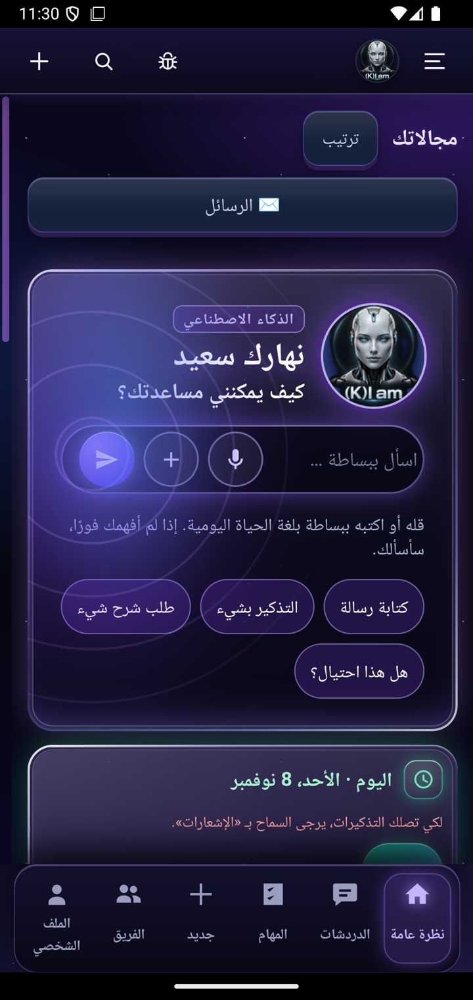
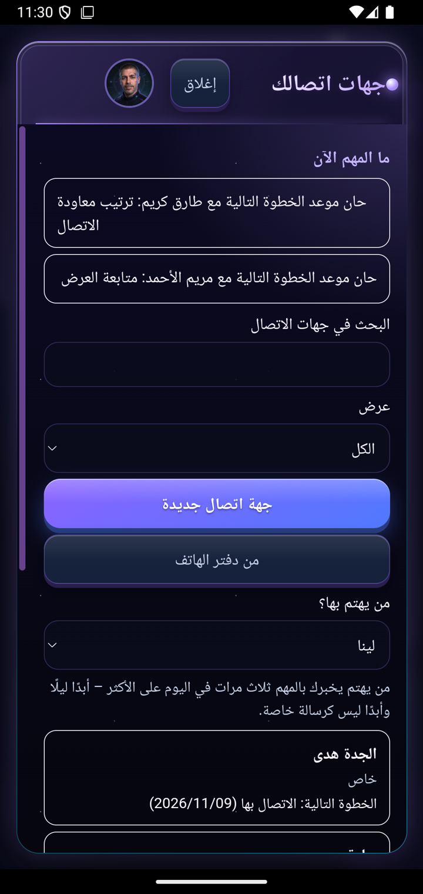
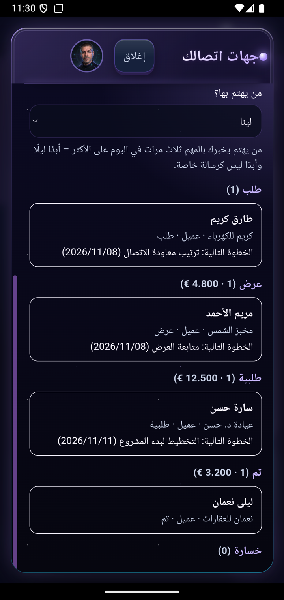
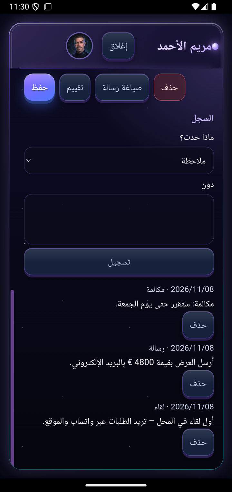
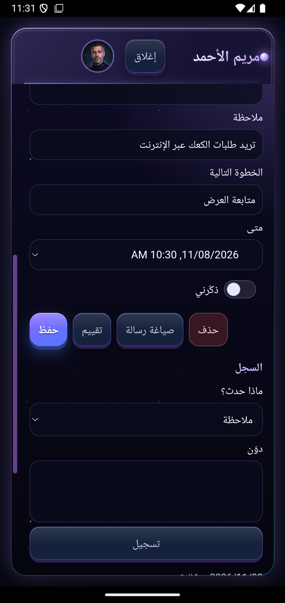

# ‏(K)I am – تطبيق ذكاء اصطناعي بفريق وكلاء خاص ونظام CRM ذكي مدمج

[Deutsch](README.md) · [English](README.en.md) · **العربية**

‏(K)I am تطبيق أندرويد له نسخة مقابلة على الحاسوب. أطوّره بمفردي منذ عام 2026 **بمساعدة الذكاء الاصطناعي**: أنا أخطط وأقرر وأتحقق، ووكلاء البرمجة بالذكاء الاصطناعي يكتبون الشيفرة تحت إشرافي. الهدف تطبيق يستطيع استخدامه شخص لا خبرة تقنية لديه.

> ملاحظة: هذه الصفحة تعرض المنتج. الشيفرة المصدرية خاصة. كل الصور مأخوذة من جهاز اختبار ببيانات مثال مختلقة (التطبيق متوفر بـ 15 لغة).

## ماذا يفعل التطبيق

- **محادثة مع الذكاء الاصطناعي**: النماذج المجانية أولًا، ويمكن إضافة مفتاح خاص. تعمل على الهاتف حتى بدون حاسوب.
- **فريق وكلاء خاص**: أعضاء فريق بالذكاء الاصطناعي لكل منهم اسم ودور وصوت ووجه، مرتبون في فرق وهيكل تنظيمي مع سير عمل.
- **تذكيرات ومواعيد ومهام**: الهاتف والحاسوب متزامنان تلقائيًا.
- **شرح الصور والرسائل**: التقط صورة، مثلًا لرسالة رسمية، فيشرحها الذكاء الاصطناعي بلغة بسيطة.
- **رسم الصور** بنموذج صور محلي.
- **15 لغة** لكامل الواجهة، منها العربية (من اليمين إلى اليسار) والروسية والتركية واليونانية.

## نظام CRM ذكي مدمج (جديد، نوفمبر 2026)

النظام موجود داخل التطبيق نفسه وليس في نظام خارجي:

- **جهات الاتصال**: عملاء وجهات اتصال خاصة وشركاء عمل، مع مراحل البيع (استفسار ← عرض ← طلب) والقيمة باليورو.
- **ما المهم الآن**: قواعد ثابتة وواضحة: خطوات حان موعدها، عروض بلا رد منذ 7 أيام، استفسارات تنتظر منذ 3 أيام.
- **وكيل يهتم بها**: وكيل من الفريق يخبرك بالمهم ثلاث مرات يوميًا على الأكثر، لا ليلًا ولا بإلحاح.
- **تقييم بضغطة زر**: يحصل الذكاء الاصطناعي على بيانات جهة الاتصال هذه فقط، مع قواعد ثابتة تمنعه من الاختلاق. ما يخمّنه فقط يشير إليه بوضوح.
- **صياغة الرسائل**: الذكاء الاصطناعي يكتب مسودة، ولا يُرسل شيء قبل مراجعتك.
- **دفتر الهاتف والمكالمات**: نقل أشخاص من دفتر الهاتف. المكالمات مع جهات اتصالك تظهر تلقائيًا في سجلها، لجهات اتصالك فقط.
- **الهاتف والحاسوب سواء**: مزامنة في الاتجاهين مع حل التعارضات. الهاتف يعمل أيضًا بدون حاسوب.

## كيف بُني

- **الهاتف**: Kotlin/Java وواجهة ويب خاصة بلغة JavaScript، تخزين مشفّر، مزامنة في الخلفية بحدود لاستهلاك البيانات.
- **الحاسوب**: خادم Python خاص، سير عمل بـ n8n، مخزن معرفة في PostgreSQL.
- **الذكاء الاصطناعي**: OpenRouter (نماذج مجانية) ونماذج محلية (Ollama)؛ إذا تعطل نموذج ينتقل التطبيق إلى غيره تلقائيًا.
- **الجودة**: أكثر من 3300 اختبار آلي بلغة Python، وأكثر من 200 اختبار للواجهة، واختبارات للهاتف؛ كل إصدار يُختبر في المحاكي قبل التسليم.
- **الحجم**: أكثر من 100000 سطر برمجي، وقرابة 400 إصدار.

## كيف أعمل

أطوّر **بقيادة الذكاء الاصطناعي**: أصف الهدف، ووكلاء الذكاء الاصطناعي (Claude Code و Codex) ينفّذونه، وأنا أتحقق من النتيجة على الجهاز. قواعد ثابتة تحفظ الجودة:
- لا تخمين، فكل ادعاء يحتاج دليلًا
- كل تغيير له اختبارات
- كل إصدار يُختبر في المحاكي قبل التسليم
- المجاني والمحلي أولًا

المعيار: يجب أن تستطيع امرأة في السبعين بلا خبرة تقنية استخدامه.

---
التواصل عبر ملفي الشخصي على GitHub.

