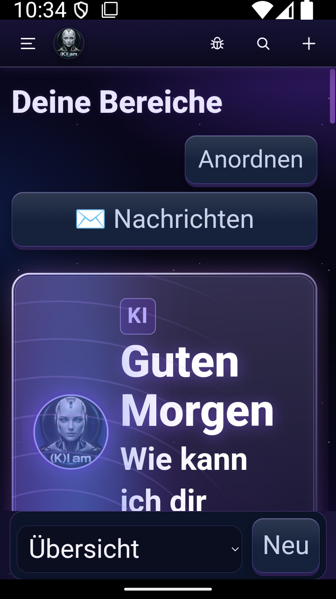
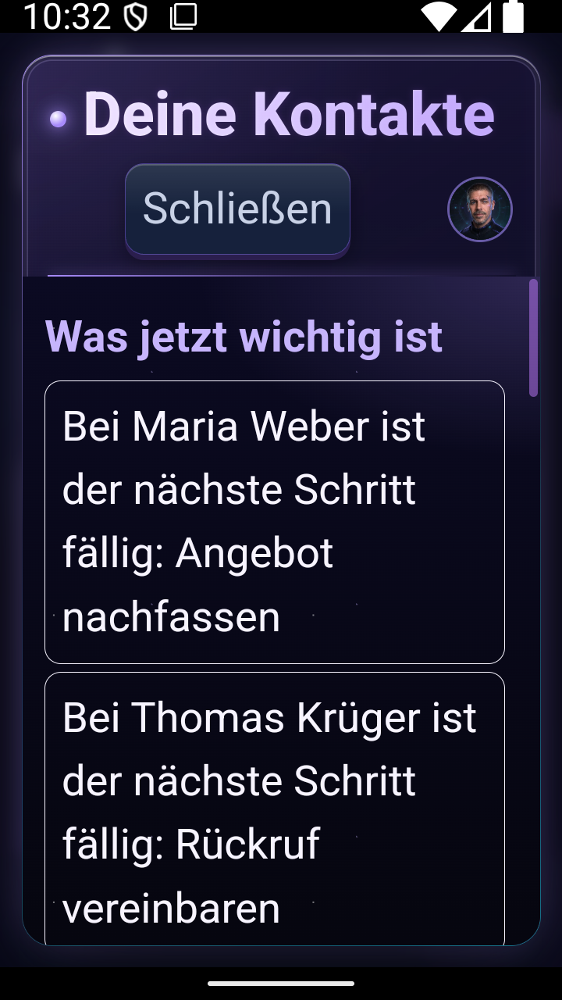
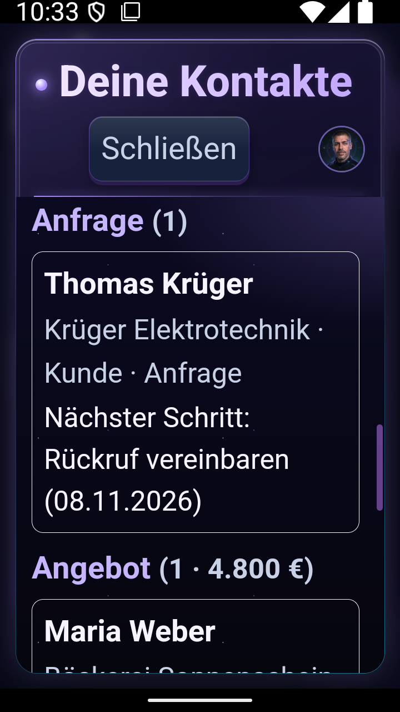
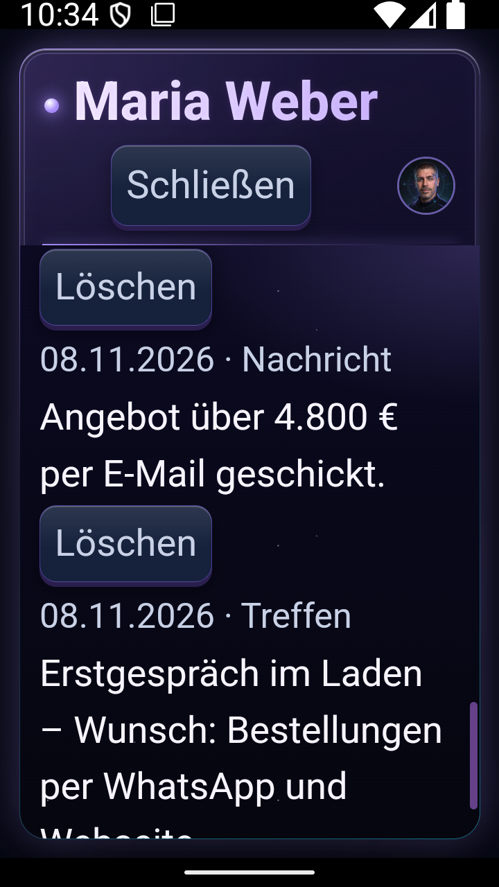
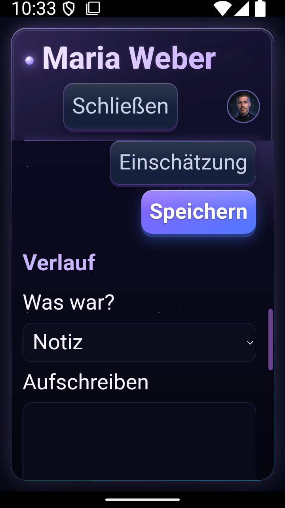

# (K)I am – an AI app with its own agent team and a native AI CRM

[Deutsch](README.md) · **English** · [العربية](README.ar.md)

(K)I am is an Android app with a PC counterpart. I have been building it on my own since 2026, **AI-driven**: I plan, decide and verify, and AI coding agents write the code under my direction. The goal is an app that someone with no technical experience can use.

> Note: this page shows the product. The source code is private. All screenshots come from a test device with made-up sample data (the app UI is shown in German; 15 languages are available).

## What the app does

- **Chat with AI**: free models first, your own API key optional. Works on the phone without a PC.
- **Your own agent team**: AI team members with name, role, voice and face, organised in teams and an org chart, with workflows.
- **Reminders, appointments, tasks**: phone and PC stay in sync automatically.
- **Explain photos and letters**: take a photo, for example of an official letter, and the AI explains it in plain language.
- **Image generation** with a local image model.
- **15 languages** for the whole interface, including Arabic (right-to-left), Russian, Turkish and Greek.

## Native AI CRM (new, November 2026)

The CRM lives inside the app, not in an external system:

| | |
|---|---|
| **Contacts** | Customers, private contacts and business partners, with a sales pipeline (enquiry → offer → order) and value in euros |
| **What matters now** | Fixed, transparent rules: due steps, offers with no reply for 7 days, enquiries waiting for 3 days |
| **An agent looks after them** | One agent from the team reports at most three times a day what matters, never at night and never pushy |
| **Assessment on demand** | The AI only gets this one contact's data plus fixed rules against making things up. Anything it only guesses, it marks as a guess. |
| **Draft messages** | The AI writes a draft; nothing is sent until you have checked it |
| **Phone book and calls** | Import people from the phone's address book. Calls with contacts appear in their history automatically, only for your own contacts. |
| **Phone and PC alike** | Two-way sync with conflict resolution. The phone also works without the PC. |

<p>





</p>

## How it is built

```
  Phone app (Android)  ◄──── sync ────►  PC program (Python)
   Kotlin + web UI                        gateway, agents, learning
          │                                     │
          └──────► own server: updates, notices, error reports
                   AI: free models first, local models (Ollama)
```

- **Phone**: Kotlin/Java, own web UI in JavaScript, encrypted storage, background sync with a data budget
- **PC**: own Python server, workflows with n8n, knowledge store in PostgreSQL
- **AI**: OpenRouter (free models) and local models; if one model fails, the app switches to another on its own
- **Quality**: more than 3,300 automated Python tests, more than 200 UI tests, phone unit tests; every release is checked in the emulator before it ships
- **Size**: more than 100,000 lines of code, almost 400 releases shipped

## How I work

I develop **AI-driven**: I describe the goal, AI agents (Claude Code, Codex) implement it, and I check the result on the device. Fixed rules keep it clean:
- no guessing, every claim needs evidence
- every change gets tests
- every release is checked in the emulator before it ships
- free and local first

The usability bar: a 70-year-old woman with no technical experience has to be able to use it.

---
Contact via my GitHub profile.
