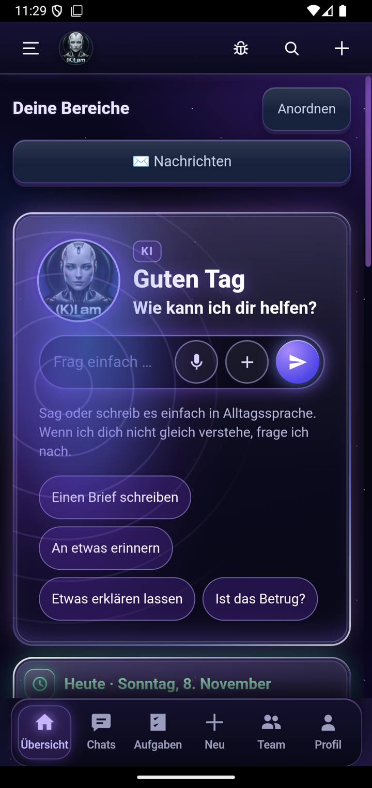
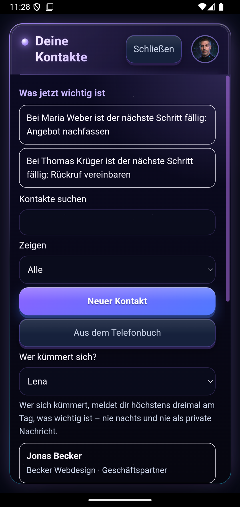
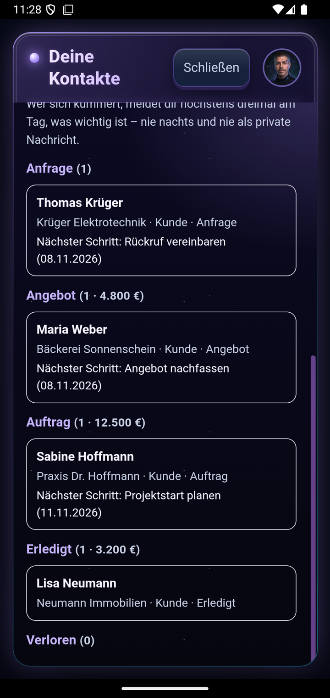
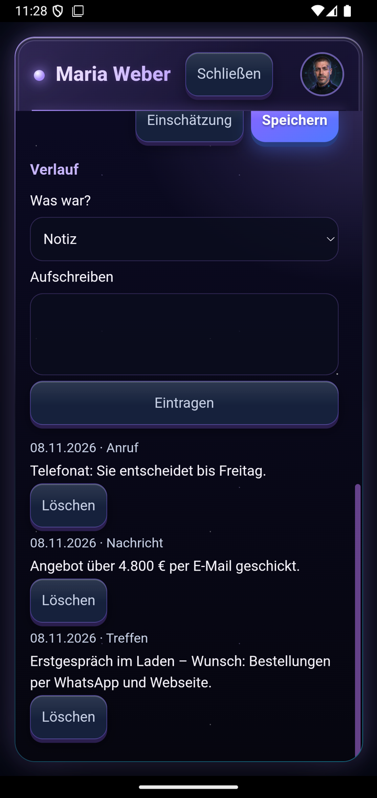
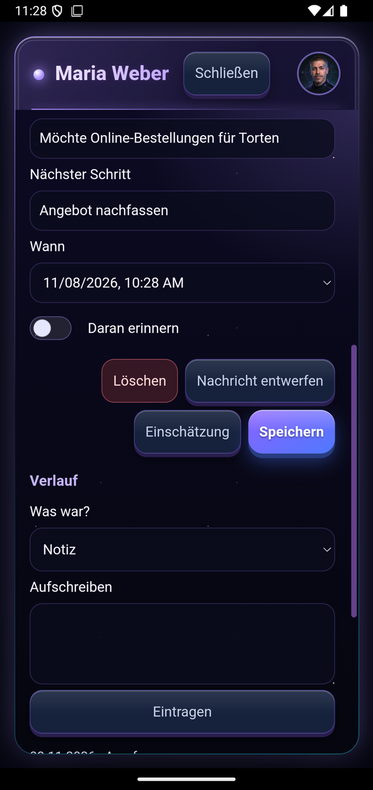

# (K)I am – eine KI-App mit eigenem Agenten-Team und nativem KI-CRM

**Deutsch** · [English](README.en.md) · [العربية](README.ar.md)

(K)I am ist eine Android-App mit PC-Gegenstück, die ich seit 2026 als Einzelperson entwickle, und zwar **KI-gestützt**: Ich plane, entscheide und prüfe, KI-Programmier-Agenten schreiben unter meiner Führung den Code. Ziel ist eine App, die auch ein Mensch ohne Technikerfahrung bedienen kann.

> Hinweis: Diese Seite zeigt das Produkt. Der Programmcode ist privat. Alle Bilder stammen aus einem Testgerät mit erfundenen Beispieldaten.

## Was die App kann

- **Chat mit KI**: kostenlose Modelle zuerst, ein eigener Schlüssel ist möglich. Auf dem Handy geht das auch ohne PC.
- **Eigenes Agenten-Team**: KI-Mitarbeitende mit Namen, Rolle, Stimme und Gesicht, in Teams und einem Organigramm geordnet, mit Arbeitsabläufen.
- **Erinnerungen, Termine, Aufgaben**: Handy und PC bleiben automatisch gleich.
- **Fotos und Briefe erklären**: Foto aufnehmen, etwa von einem Amtsbrief, und die KI erklärt ihn in einfacher Sprache.
- **Bilder malen** mit lokalem Bildmodell.
- **15 Sprachen** für die ganze Oberfläche, darunter Arabisch (von rechts nach links), Russisch, Türkisch und Griechisch.

## Natives KI-CRM (neu, November 2026)

Das CRM steckt direkt in der App, nicht in einem fremden System:

| | |
|---|---|
| **Kontakte** | Kunden, private Kontakte und Geschäftspartner, mit Verkaufsstand (Anfrage → Angebot → Auftrag) und Wert in Euro |
| **Was jetzt wichtig ist** | feste, nachvollziehbare Regeln: fällige Schritte, Angebote ohne Rückmeldung seit 7 Tagen, Anfragen, die seit 3 Tagen warten |
| **Ein Agent kümmert sich** | Ein Agent aus dem Team meldet höchstens dreimal am Tag, was wichtig ist, nie nachts und nie aufdringlich |
| **Einschätzung auf Knopfdruck** | Die KI bekommt nur die Daten dieses einen Kontakts und feste Regeln gegen Erfundenes. Was sie nur vermutet, kennzeichnet sie. |
| **Nachrichten entwerfen** | Die KI schreibt einen Entwurf, verschickt wird erst nach deiner Prüfung |
| **Telefonbuch und Anrufe** | Leute aus dem Handy-Telefonbuch übernehmen. Telefonate mit Kontakten stehen von selbst im Verlauf, nur für eigene Kontakte. |
| **Handy und PC gleich** | Abgleich mit Konfliktlösung in beide Richtungen. Das Handy arbeitet auch ohne PC. |

<p>





</p>

## Wie es gebaut ist

```
  Handy-App (Android)  ◄──── Abgleich ────►  PC-Programm (Python)
   Kotlin + Web-Oberfläche                    Gateway, Agenten, Lernen
          │                                          │
          └──────► eigener Server: Updates, Hinweise, Fehlermeldungen
                   KI: kostenlose Modelle zuerst, lokale Modelle (Ollama)
```

- **Handy**: Kotlin/Java, eigene Web-Oberfläche in JavaScript, verschlüsselte Ablage, Hintergrund-Abgleich mit Datenbudget
- **PC**: eigener Python-Server, Workflows mit n8n, Wissensspeicher in PostgreSQL
- **KI**: OpenRouter (kostenlose Modelle) und lokale Modelle; die App weicht von selbst auf ein anderes Modell aus, wenn eines ausfällt
- **Qualität**: über 3.300 automatische Python-Tests, über 200 Oberflächen-Tests, Handy-Tests; jede Fassung wird vor der Auslieferung im Emulator geprüft
- **Umfang**: über 100.000 Zeilen Code, fast 400 ausgelieferte Fassungen

## Wie ich arbeite

Ich entwickle **KI-getrieben**: Ich beschreibe das Ziel, KI-Agenten (Claude Code, Codex) setzen es um, und ich prüfe das Ergebnis am Gerät. Feste Regeln halten das sauber:
- nichts raten, jede Aussage braucht einen Beleg
- jede Änderung bekommt Tests
- vor der Auslieferung wird im Emulator geprüft
- kostenlos und lokal zuerst

Der Maßstab für die Bedienung: Eine 70-jährige Frau ohne Technikerfahrung muss damit zurechtkommen.

---
Kontakt über mein GitHub-Profil.
